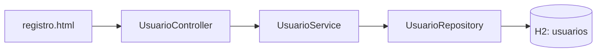

# Modelo implementado para #10

Este modelo representa únicamente el flujo existente, no el diseño futuro completo.

| Atributo de Usuario | Tipo Java | Columna |
| --- | --- | --- |
| id | Long | Clave primaria generada |
| email | String | No nula y única |
| nombre | String | No nula |
| apellidos | String | No nula |
| tipoDocumento | String | No nula, longitud 10 |
| paisEmisor | String | No nula, longitud 2 |
| numeroDocumento | String | No nula, longitud 32 |

Actualización local del 20/10/2026, pendiente de revisión e integración:
email, nombre y apellidos usan longitud por defecto de JPA: 255.
Existe una restricción única compuesta por tipo_documento, pais_emisor y numero_documento.
Las reglas se explican en [decisiones](../decisions/registro-usuarios.md). No hay relaciones JPA en este
incremento. Roles, propietarios, inmuebles y reservas quedan pendientes de sus
issues y de las aclaraciones del cliente.
