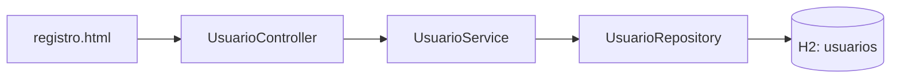

# Modelo implementado para #10

Este modelo representa únicamente el flujo existente, no el diseño futuro completo.
Código de referencia: `1258bb7289c49d898336e8163368434afc24afd4`.

| Atributo de Usuario | Tipo Java | Columna |
| --- | --- | --- |
| id | Long | Clave primaria generada |
| email | String | No nula y única |
| nombre | String | No nula |
| apellidos | String | No nula |
| tipoDocumento | String | No nula, longitud 10 |
| paisEmisor | String | No nula, longitud 2 |
| numeroDocumento | String | No nula, longitud 32 |
| rol | String | No nula, longitud 20: INQUILINO o PROPIETARIO |

Modelo de la ampliación aprobada por Alex e integrada mediante
[#36](https://github.com/albertojramosf06-source/ForjaBiteCompany/pull/36) el 20/10/2026:
email, nombre y apellidos usan longitud por defecto de JPA: 255.
Existe una restricción única compuesta por tipo_documento, pais_emisor y numero_documento.
Las reglas se explican en [decisiones](../decisions/registro-usuarios.md). No hay relaciones JPA en este
incremento. Roles, propietarios, inmuebles y reservas quedan pendientes de sus
issues y de las aclaraciones del cliente.

Ampliación de [#11](https://github.com/albertojramosf06-source/ForjaBiteCompany/issues/11) (26/10/2026): se añade `rol`. El mismo
controlador atiende `/usuarios/registro` (rol INQUILINO) y `/propietarios/registro`
(rol PROPIETARIO). Ver [decisión de #11](../decisions/registro-propietarios.md).
