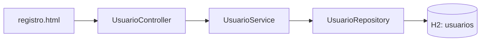

# Modelo implementado para #10

Este modelo representa únicamente el flujo existente, no el diseño futuro completo.

| Atributo de Usuario | Tipo Java | Columna |
| --- | --- | --- |
| id | Long | Clave primaria generada |
| email | String | No nula y única |
| nombre | String | No nula |
| apellidos | String | No nula |
| dni | String | No nula |

Las cadenas usan longitud por defecto de JPA: 255. No hay relaciones JPA en este
incremento. Roles, propietarios, inmuebles y reservas quedan pendientes de sus
issues y de las aclaraciones del cliente.
